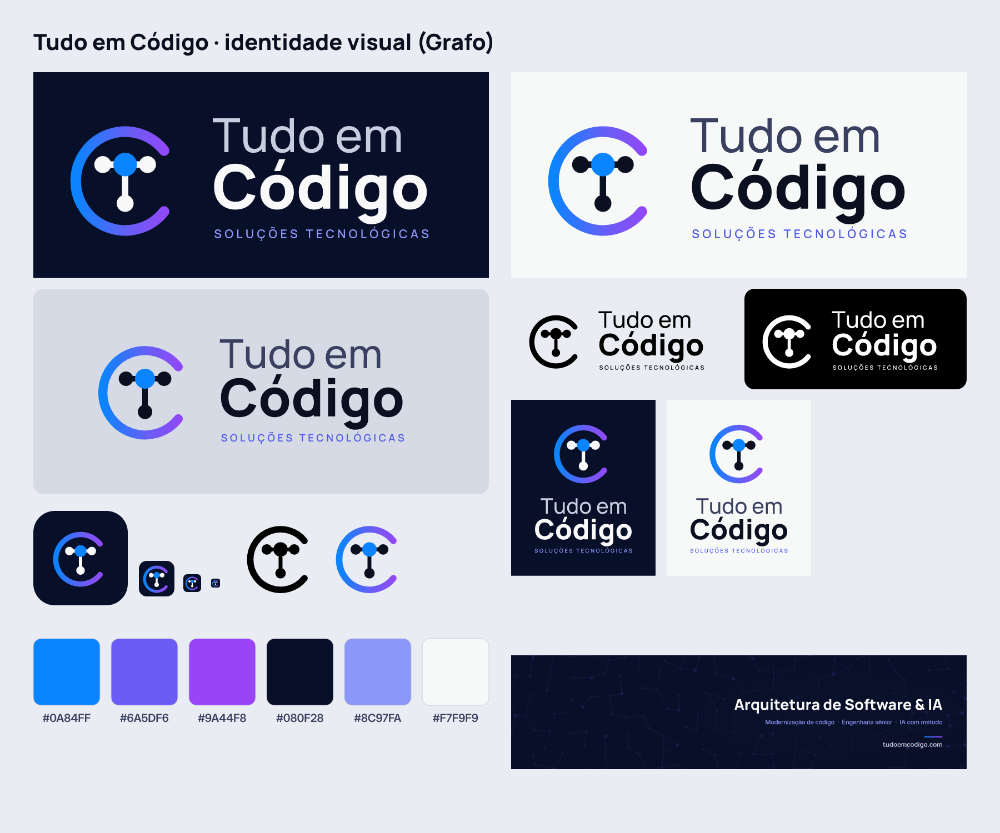
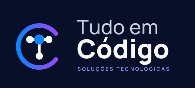
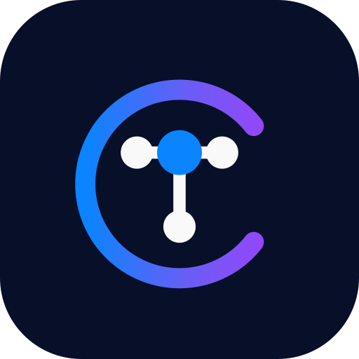
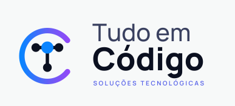
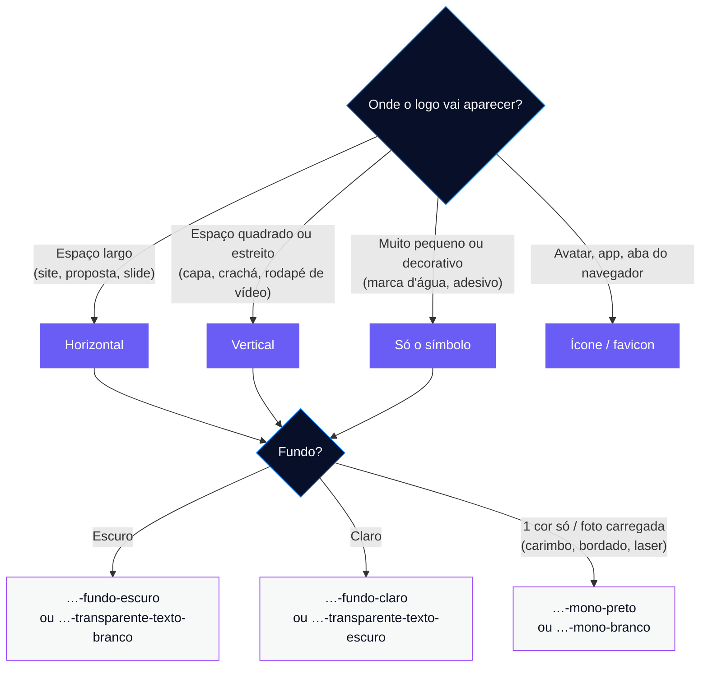
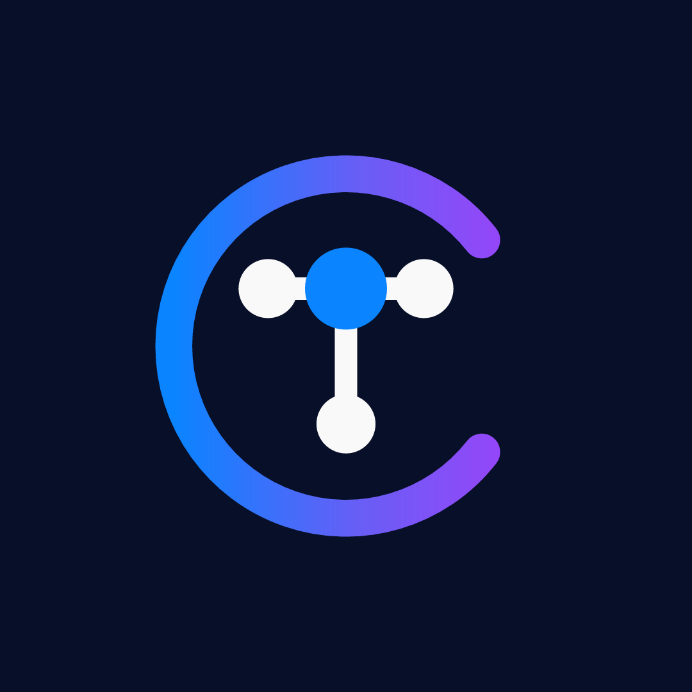
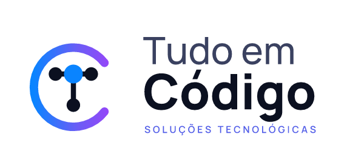

<div align="center">

<picture>
  <source media="(prefers-color-scheme: dark)" srcset="SVG/tudoemcodigo-vertical-transparente-texto-branco.svg">
  
</picture>

# Guia da Marca · Grafo

*A identidade oficial da Tudo em Código*


[🏠 Início](../README.md) · [📣 Marketing e Marca](../04-Marketing-e-Marca.md)

</div>

---

> [!NOTE]
> Marca oficial da Tudo em Código desde **13/10/2026** (plano v1). É a única identidade em uso: todo material publicado sai com o Grafo.

## 📑 Sumário

- [Visão geral](#-visão-geral)
- [O conceito](#-o-conceito)
- [Versões do logo](#️-versões-do-logo)
- [Qual arquivo usar](#-qual-arquivo-usar)
- [Cores](#-cores)
- [Tipografia](#-tipografia)
- [Elemento gráfico](#️-elemento-gráfico)
- [Regras de uso](#-regras-de-uso)
- [Redes sociais](#-redes-sociais)
- [Perfil no Instagram](#-perfil-no-instagram-tudoemcodigo-já-está-em-uso)
- [Código pronto para o site e o e-mail](#-código-pronto-para-o-site-e-o-e-mail)
- [Estrutura da pasta](#-estrutura-da-pasta)
- [Regerar os arquivos](#-regerar-os-arquivos)
- [Antes de registrar no INPI](#️-antes-de-registrar-no-inpi)

---

## 👀 Visão geral

Tudo numa imagem só:

<p align="center">
  
</p>

---

## 💡 O conceito

<table>
<tr>
<td width="140" align="center">

</td>
<td>

Um **"T" feito de nós conectados** dentro de um **"C" em órbita**.

| Os nós representam… | …a linha da empresa |
|---|---|
| 🌳 uma árvore de sintaxe | **código** |
| 🧠 uma rede neural | **IA** |
| 📚 uma estrutura de conhecimento | **ensino** |

O **nó central, em azul**, é o ponto onde tudo se conecta: a Tudo em Código.

</td>
</tr>
</table>

---

## 🖼️ Versões do logo

| Horizontal | Vertical | Símbolo |
|:-:|:-:|:-:|
|  |  |  |
|  |  |  |
|  |  |  |

<sub>Cada versão existe em **6 variantes**: `fundo-escuro`, `fundo-claro`, `transparente-texto-branco`, `transparente-texto-escuro`, `mono-preto` e `mono-branco`.</sub>

---

## 🧭 Qual arquivo usar



| Situação | Arquivo |
|---|---|
| 🌙 Site, propostas, slides escuros | `SVG/tudoemcodigo-horizontal-fundo-escuro.svg` ou `…-transparente-texto-branco.svg` |
| ☀️ Documentos, contratos, slides claros | `SVG/tudoemcodigo-horizontal-transparente-texto-escuro.svg` ou `…-fundo-claro.svg` |
| 🪪 Espaços quadrados ou estreitos (capa de relatório, crachá, cartão em pé, rodapé de vídeo) | `SVG/tudoemcodigo-vertical-…` (mesmas 6 variantes) |
| 🖨️ Impressão a uma cor, carimbo, bordado, gravação a laser | `SVG/…-mono-preto.svg` / `…-mono-branco.svg` |
| 💧 Só o símbolo (marca d'água, canto de slide, adesivo) | `SVG/tudoemcodigo-simbolo-cores-fundo-escuro.svg`, `…-cores-fundo-claro.svg`, `…-mono-…` |
| 📱 Ícone de app, avatar quadrado | `SVG/tudoemcodigo-icone-app.svg` · `PNG/tudoemcodigo-icone-1024.png` / `-512.png` |
| 🌐 Favicon do site | `PNG/favicon.ico` (16/32/48) + `SVG/tudoemcodigo-favicon.svg` + `PNG/tudoemcodigo-icone-180-apple-touch.png` |
| 📝 Quem não aceita SVG (Word, alguns sites) | `PNG/` (horizontal 2400 px, vertical 1600 px, símbolo 1024 px) |

> [!TIP]
> **Para gráfica:** envie sempre o **SVG**. Todo o texto está em curvas, então não depende de fonte instalada. Se pedirem PDF/EPS, abra o SVG no [Inkscape](https://inkscape.org) (gratuito) ou no Illustrator e exporte.

---

## 🎨 Cores

**Gradiente da marca** (aplicado no "C", da esquerda para a direita):


```css
/* Gradiente oficial: azul 0% → índigo 55% → violeta 100% */
background: linear-gradient(90deg, #0A84FF 0%, #6A5DF6 55%, #9A44F8 100%);
```

| Uso | 🌙 Fundo escuro | ☀️ Fundo claro |
|---|---|---|
| **Fundo** |  `#080F28` |  `#F7F9F9` |
| **"Código" / nós** |  `#F9F9FA` |  `#0B1020` |
| **"Tudo em"** |  `#C9CDE0` |  `#3A4160` |
| **Tagline / destaques** |  `#8C97FA` |  `#4F5BE8` |
| **Nó central** |  `#0A84FF` |  `#0A84FF` |

<details>
<summary><b>📋 Variáveis CSS prontas para o site</b></summary>

```css
:root {
  /* Marca */
  --tc-azul:    #0A84FF;
  --tc-indigo:  #6A5DF6;
  --tc-violeta: #9A44F8;
  --tc-gradiente: linear-gradient(90deg, #0A84FF 0%, #6A5DF6 55%, #9A44F8 100%);

  /* Tema claro */
  --tc-fundo:     #F7F9F9;
  --tc-texto:     #0B1020;
  --tc-texto-2:   #3A4160;
  --tc-destaque:  #4F5BE8;
}

@media (prefers-color-scheme: dark) {
  :root {
    --tc-fundo:     #080F28;
    --tc-texto:     #F9F9FA;
    --tc-texto-2:   #C9CDE0;
    --tc-destaque:  #8C97FA;
  }
}
```

</details>

---

## 🔤 Tipografia

Todas gratuitas, do [Google Fonts](https://fonts.google.com), com licença **OFL** (pode usar comercialmente).

| Uso | Fonte | Pesos |
|---|---|---|
| Logo, títulos, chamadas | [**Manrope**](https://fonts.google.com/specimen/Manrope) | "Tudo em" **Medium** · "Código" **ExtraBold** · títulos **ExtraBold** |
| Texto corrido (site, propostas, posts) | [**Inter**](https://fonts.google.com/specimen/Inter) | Regular / Medium |
| Código em posts, slides e relatórios | [**JetBrains Mono**](https://fonts.google.com/specimen/JetBrains+Mono) | Regular |

<details>
<summary><b>📋 Importar as fontes no site</b></summary>

```html
<link rel="preconnect" href="https://fonts.googleapis.com">
<link rel="preconnect" href="https://fonts.gstatic.com" crossorigin>
<link href="https://fonts.googleapis.com/css2?family=Inter:wght@400;500&family=JetBrains+Mono&family=Manrope:wght@500;800&display=swap" rel="stylesheet">
```

```css
body          { font-family: "Inter", system-ui, sans-serif; }
h1, h2, h3    { font-family: "Manrope", sans-serif; font-weight: 800; }
code, pre     { font-family: "JetBrains Mono", monospace; }
```

</details>

---

## 🕸️ Elemento gráfico

A **rede de nós e arestas** (a mesma linguagem do símbolo) aparece bem discreta no fundo de capas e banners:

| Parâmetro | Valor |
|---|---|
| Cor | `#6A5DF6` (índigo) |
| Opacidade | **10–16%** |
| Onde usar | Capas dos relatórios do Diagnóstico Expresso, notas de versão do Plantão, slides do workshop, capa do Radar da Nota Técnica, capas da aula aberta |
| Onde **não** usar | Atrás de texto pequeno |

---

## 📏 Regras de uso

| Regra | Tela | Impresso |
|---|:-:|:-:|
| Largura mínima · horizontal | **140 px** | **35 mm** |
| Largura mínima · vertical | **90 px** | **22 mm** |
| Largura mínima · símbolo | **16 px** (use o favicon) | — |
| Área de proteção | espaço livre em volta = **diâmetro do nó central** | idem |

> [!IMPORTANT]
> **Versões mono:** o nó central tem um **anel vazado** para não se fundir com as linhas. Use sempre os arquivos `mono`; nunca pinte a versão colorida de uma cor só.

<table>
<tr>
<th width="50%">✅ Fazer</th>
<th width="50%">❌ Não fazer</th>
</tr>
<tr>
<td valign="top">

- Usar os arquivos originais da pasta `SVG/`
- Respeitar a área de proteção
- Usar a versão **mono** sobre fotos com muita informação
- Usar o **favicon** em tamanhos abaixo de 32 px
- Enviar **SVG** para a gráfica

</td>
<td valign="top">

- Esticar, achatar ou girar
- Trocar as cores ou a ordem do gradiente
- Aplicar sombra, contorno, brilho ou efeito
- Separar o "T" do "C"
- Pôr a versão colorida sobre foto carregada
- Redesenhar o texto com outra fonte

</td>
</tr>
</table>

---

## 📲 Redes sociais

Arquivos em `redes-sociais/`, já nos tamanhos de cada plataforma:

| Prévia | Arquivo | Tamanho | Onde usar |
|:-:|---|:-:|---|
|  | `avatar-perfil-1080.png` | 1080×1080 | Foto de perfil no Instagram, LinkedIn (página), YouTube e WhatsApp Business. O símbolo já cabe no recorte circular |
|  | `linkedin-banner-1584x396.png` | 1584×396 | Capa do LinkedIn (perfil do Roberto e página da empresa). Texto à direita porque a foto cobre o canto inferior esquerdo |
|  | `youtube-capa-2560x1440.png` | 2560×1440 | Capa do canal. Logo e frase dentro da área segura de 1546×423 (celular, TV e computador) |
|  | `site-compartilhamento-og-1200x630.png` | 1200×630 | Imagem que aparece quando o link do site é colado no WhatsApp/LinkedIn (`og:image`) |
|  | `instagram-post-modelo-1080x1350.png` | 1080×1350 (4:5) | Modelo de capa de carrossel: símbolo no topo, título com a última linha em gradiente, linha de apoio, rodapé com o @ |
|  | `assinatura-email-logo-600.png` | 600 px | Logo da assinatura de e-mail (exibir com **300 px**; o arquivo é 2× para telas de alta resolução) |

---

## 📸 Perfil no Instagram (`@tudoemcodigo` já está em uso)

> [!IMPORTANT]
> **Regra:** o **mesmo @ em todas as redes** (Instagram, YouTube, TikTok, Threads) e o mais perto possível do domínio `tudoemcodigo.com`.

| # | Sugestão | Prós | Contras |
|:-:|---|---|---|
| ⭐ 1 | **`@tudoemcodigo.com`** *(recomendado)* | **Igual ao domínio e ao e-mail**; quem busca "tudoemcodigo" encontra; já ensina o endereço do site | Fica ao lado do perfil que já existe: avatar e bio precisam deixar claro quem é quem |
| 2 | `@tudoemcodigo.dev` | Curto, moderno, conversa com quem programa | Afasta escolas e famílias |
| 3 | `@tudoemcodigo.oficial` | Deixa claro qual é o perfil verdadeiro | Mais longo |
| 4 | `@tudo.em.codigo` | Lê-se naturalmente; fácil de falar em vídeo | Muito parecido com o @ ocupado: fácil marcar o perfil errado |
| 5 | `@tudoemcodigo.tech` | Neutro | Menos ligado ao domínio |
| 6 | `@sou.tudoemcodigo` | Cara de comunidade | Mais longo |
| 7 | `@roberto.emcodigo` | Marca pessoal do professor (ensinar em público) | É um segundo perfil, não o da empresa |

**Antes de criar:**

- [ ] Confirmar se o nome está livre **direto no app** (o Instagram não deixa verificar de fora com segurança)
- [ ] Testar o mesmo @ no YouTube (`youtube.com/@…`) e no TikTok
- [ ] Ver se o `@tudoemcodigo` atual está **inativo** (sem posts há anos). Plano B: depois do depósito no **INPI**, denunciar violação de marca se o perfil usar o nome comercialmente (não é garantido)
- [ ] Se escolher outro @, regerar o post-modelo (ver [Regerar os arquivos](#-regerar-os-arquivos))

<details>
<summary><b>✍️ Sugestão de bio</b></summary>

```text
Tudo em Código
Arquitetura de software e engenharia de IA
Modernização de legados e conformidade técnica
👇 tudoemcodigo.com
```

<sub>Até 150 caracteres. Ajuste a última linha para o link da campanha do mês.</sub>

</details>

---

## 🧩 Código pronto para o site e o e-mail

<details>
<summary><b>🌐 Favicon, ícone e compartilhamento (colar no <code>&lt;head&gt;</code>)</b></summary>

Copie `PNG/favicon.ico`, `SVG/tudoemcodigo-favicon.svg`, `PNG/tudoemcodigo-icone-180-apple-touch.png` e `redes-sociais/site-compartilhamento-og-1200x630.png` para a raiz do site:

```html
<!-- Favicon -->
<link rel="icon" href="/favicon.ico" sizes="any">
<link rel="icon" href="/tudoemcodigo-favicon.svg" type="image/svg+xml">
<link rel="apple-touch-icon" href="/tudoemcodigo-icone-180-apple-touch.png">
<meta name="theme-color" content="#080F28">

<!-- Compartilhamento (WhatsApp, LinkedIn, Facebook) -->
<meta property="og:type" content="website">
<meta property="og:site_name" content="Tudo em Código">
<meta property="og:title" content="Tudo em Código · Arquitetura de Software & IA">
<meta property="og:description" content="Arquitetura de software e engenharia de IA aplicada. Modernização de código legado e engenharia de alta performance.">
<meta property="og:url" content="https://tudoemcodigo.com">
<meta property="og:image" content="https://tudoemcodigo.com/site-compartilhamento-og-1200x630.png">
<meta property="og:image:width" content="1200">
<meta property="og:image:height" content="630">
<meta property="og:locale" content="pt_BR">
<meta name="twitter:card" content="summary_large_image">
```

> O `og:image` precisa de **URL absoluta** (com `https://`), senão o WhatsApp não mostra a imagem.

</details>

<details>
<summary><b>✉️ Assinatura de e-mail (HTML)</b></summary>

Hospede `redes-sociais/assinatura-email-logo-600.png` no site (ex.: `https://tudoemcodigo.com/assinatura-email-logo-600.png`) e cole no Gmail/Outlook:

```html
<table cellpadding="0" cellspacing="0" style="font-family:Inter,Arial,sans-serif;color:#0B1020;font-size:13px;line-height:1.5">
  <tr><td style="padding-bottom:8px">
    
  </td></tr>
  <tr><td>
    <strong>Roberto Oliveira</strong> · Arquiteto de Software e Fundador<br>
    <span style="color:#4F5BE8">Arquitetura de Software & Engenharia de IA</span><br>
    <a href="https://tudoemcodigo.com" style="color:#0A84FF;text-decoration:none">tudoemcodigo.com</a> ·
    <a href="mailto:contato@tudoemcodigo.com" style="color:#0A84FF;text-decoration:none">contato@tudoemcodigo.com</a>
  </td></tr>
</table>
```

</details>

---

## 📁 Estrutura da pasta

```text
marca/
├── LEIA-ME-Marca.md        ← este guia
├── Previa-Marca.png        ← visão geral em uma imagem
├── SVG/                    ← 18 arquivos vetoriais (use sempre que possível)
│   ├── tudoemcodigo-horizontal-{6 variantes}.svg
│   ├── tudoemcodigo-vertical-{6 variantes}.svg
│   ├── tudoemcodigo-simbolo-{cores|mono}-….svg
│   ├── tudoemcodigo-icone-app.svg
│   └── tudoemcodigo-favicon.svg
├── PNG/                    ← para quem não aceita SVG
│   ├── …-horizontal-…-2400.png   …-vertical-…-1600.png   …-simbolo-…-1024.png
│   ├── tudoemcodigo-icone-1024 / 512 / 180-apple-touch.png
│   └── favicon.ico + tudoemcodigo-favicon-16 / 32 / 48.png
├── redes-sociais/          ← 6 peças prontas (avatar, banners, og:image, post, e-mail)
└── _fonte-gerador/         ← recria tudo acima
    ├── gerar_marca.py
    ├── textos-do-logo.svg  ← curvas do texto do logo
    └── fontes/             ← Manrope.ttf, Inter.ttf (OFL)
```

---

## 🔄 Regerar os arquivos

O script `_fonte-gerador/gerar_marca.py` recria **todos** os arquivos de `SVG/`, `PNG/`, `redes-sociais/` e a `Previa-Marca.png`.

**1. Instalar as dependências** (uma vez):

```bash
pip install resvg-py pillow fonttools uharfbuzz
```

**2. Rodar a partir desta pasta (`marca/`):**

```bash
python _fonte-gerador/gerar_marca.py _fonte-gerador/textos-do-logo.svg _fonte-gerador/fontes . @tudoemcodigo.com
```

| Argumento | O que é |
|---|---|
| `_fonte-gerador/textos-do-logo.svg` | Curvas do texto do logo (aprovadas) |
| `_fonte-gerador/fontes` | Pasta com Manrope e Inter |
| `.` | Pasta de saída (`.` sobrescreve os arquivos atuais; use outra pasta para testar) |
| `@tudoemcodigo.com` | *(opcional)* @ do rodapé do post-modelo; o padrão é `@tudoemcodigo.com` |

> [!WARNING]
> Com saída `.`, os arquivos atuais são **substituídos**. Para testar mudanças, gere numa pasta separada fora do projeto (ex.: `C:/temp/teste-marca`) e compare antes.

---

## ®️ Antes de registrar no INPI

- [ ] Depositar a marca **nominativa** "Tudo em Código" (classes **42** — software — e **41** — treinamento)
- [ ] Fazer busca de anterioridade nas classes 42 e 41 antes de depositar a marca **mista** (nome + símbolo)

> [!NOTE]
> O símbolo é original (geometria simples: arco, linhas e círculos), mas a busca de anterioridade continua obrigatória.

<div align="center">

<br>

<sub>**Tudo em Código** · identidade Grafo · [voltar ao plano da empresa](../README.md)</sub>

</div>
